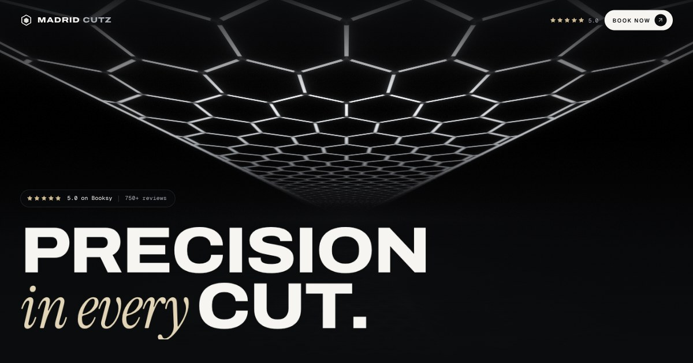

# Madrid Cutz — website

A cinematic, mobile-first website for **Madrid Cutz**, a barbershop at 901 Auburn Way N, Suite D, Auburn, WA 98002.
Every booking button goes to the shop's real Booksy profile. Nothing here replaces Booksy.



## Run it

```bash
cd madrid-cutz
npm install
npm run dev        # http://localhost:5173
npm run build      # type-check + production build into dist/
npm run preview    # serve the production build locally
```

`dist/` is a plain static site, so it can be hosted on Netlify, Vercel, Cloudflare Pages, GitHub Pages or any web server. No backend,
API keys or paid services are needed.

## Stack

React 19 · TypeScript · Vite · Tailwind CSS v4 · Motion · Lucide icons · vite-imagetools (AVIF/WebP pipeline) · self-hosted
fonts (Cinzel, Archivo variable, Geist).

## Built around the logo

The client's emblem (crown, MC monogram, clippers and the hexagon-lit shop) is the centrepiece. It stands in front of the
live hex-light ceiling in the hero, and it also appears in the nav lockup, on every barber card, in the "Look sharp"
section, the final call to action, the footer, the
favicon/app icons and the share image. A light sweep runs across its metal, clipped to the emblem's own outline. The type
and colour system come from the emblem as well: chrome serif capitals (Cinzel) like "MADRID", brushed gold like the crown
and "CUTZ", and widely tracked caps for labels. Details are in [docs/CONTENT.md](docs/CONTENT.md#logo-and-brand).

## The signature visual

The shop is recognisable by its ceiling of white hexagonal LED tubes. Instead of a stock video, the hero, the "Look sharp. Feel
different." moment and several backdrops are a **real-time WebGL render of that ceiling**
(`src/components/hex/`). It covers the dark connectors at each joint, the border tube, a polished stone floor reflection, a
fluorescent "power-on" sequence and a slow dolly. It weighs a few KB and stays sharp at any resolution. It honours
`prefers-reduced-motion` (single still frame), pauses off-screen and falls back to a gradient without WebGL.

Static stills of the same renderer live in `src/assets/art/`, regenerated with `npm run render:art` while the dev server runs.
They are clearly renders, not photos, and they are never presented as client work.

## Content and photos

All business facts live in **`src/content/site.ts`**. Anything that is not verified stays hidden behind a `verified` flag. The
details are in **[docs/CONTENT.md](docs/CONTENT.md)**: what is verified, what is waiting for confirmation, and how to add real
photos (drop files into `src/assets/photos/…` and they appear automatically).

## Project structure

```
src/
  content/site.ts        business facts, services, barbers, reviews (verified-only)
  content/media.ts       auto-discovery + optimisation of real photos
  components/hex/        WebGL hex-LED ceiling (shader + React wrapper)
  components/sections/   Hero, TrustStrip, About, Services, Gallery (+ Lightbox), Barbers, Reviews,
                         Cinematic, Visit, FinalCta
  components/layout/     Nav (+ mobile menu), Footer, MobileBookBar
  components/ui/         BookLink, Reveal animations, primitives (Picture, Stars, HexMark…)
  lib/analytics.ts       provider-agnostic event layer (no tracking until approved)
scripts/                 still-render + social-image generators (dev only)
docs/                    content verification guide, growth roadmap
```

## Quality checklist (verified in a real browser at 1440×900, 1366×657, 1280×800, 820×1180, 390×844 and 360×640)

- No horizontal overflow at desktop or mobile widths, and no console errors in dev or the production build.
- All 21 booking CTAs point to `https://booksy.com/en-us/1090147_madrid-cutz_barber-shop_39184_auburn` and open in a new tab.
- Every in-page anchor resolves. The page has one `<h1>`, and every image has alt text (decorative images use an empty `alt`).
- Gallery: category filters, lightbox with ← → / Esc, focus trap, focus return, scroll lock and touch swipe.
- Mobile menu: focus trap, Esc to close, and accurate anchor jumps. The sticky mobile "Book now" bar hides near the final CTA.
- Reduced-motion users get static renders and no transform animations.
- SEO: descriptive title/description targeting "barbershop Auburn WA" and "haircuts Auburn Washington", Open Graph/Twitter
  card, and `HairSalon` JSON-LD with verified fields only.

## Demo videos

Fast walkthroughs for sharing are in [`demo/`](demo/): `madrid-cutz-desktop.mp4` (1080p) and `madrid-cutz-mobile.mp4`
(phone portrait). Regenerate them with `npm run demo:desktop` / `npm run demo:mobile` while `npm run preview` runs.

## Before launch

1. Work through the checklist in [docs/CONTENT.md](docs/CONTENT.md): live review count, roster, hours, phone and socials.
2. Swap the gallery and About photos (currently ~550px crops of the shop's Booksy portfolio) for the original files, and
   confirm the shop is happy to show them. Barber portraits also switch on by themselves when added.
3. Once the domain is known, make `og:image` an absolute URL and add `<link rel="canonical">` plus `url` in the JSON-LD.
4. Optional growth features are described in [docs/GROWTH.md](docs/GROWTH.md). None are active.
